  

  
  
  
  

  

I'm an ML engineer based in Erlangen, Germany, studying for an M.Sc. in Electromobility at FAU (AI & Autonomous Driving). I like problems where physics, data and software meet: correcting orbit propagators with learned residuals, automating annotation for industrial computer vision, and building the backends that put these models in front of users.

---

### Recent work

| When | Role | Highlights |
| :--- | :--- | :--- |
| **Apr – Oct 2026**  ✅ Completed | **Project Thesis** · FAPS, FAU Erlangen-Nürnberg  Residual Learning for Satellite Orbit Prediction (Hybrid SGP4 + LSTM) | Cut 1-hour position RMSE from **0.569 km → 0.098 km (−82.9%)** vs. SGP4 alone; velocity error −90.4%, still −36% at 24 h. Traced long-horizon loss to a ~93-min along-track oscillation via RTN decomposition and spectral analysis. Fully reproducible PyTorch repo with negative results reported openly. |
| **Mar – Aug 2026**  ✅ Completed | **Freelance AI Backend Engineer** · Kaampass (UK) | Built a retrieval pipeline from scratch (chunking, embeddings, similarity search) reaching **91% retrieval accuracy** on real job-matching data. FastAPI backend on PostgreSQL / Supabase, deployed live. |
| **Oct 2025 – Feb 2026** | **Computer Vision Intern** · FranconAI, Erlangen | Automated CVAT annotation for wire-harness diagrams: OCR preprocessing, rotated-box inference (Gliding Vertex / MMRotate) in Docker, and a bandit-style optimizer for class-wise thresholds. **~70% fewer spurious predictions, 3.2× annotation throughput.** |
| **Oct 2026 – now**  🛠️ Building | **NexOrg ERP** · personal project | Role-based hotel operations platform (React, TypeScript, Node.js, PostgreSQL, Prisma) on AWS with Docker and GitHub Actions CI/CD; race-condition-safe bookings and 150+ automated tests. |

### Selected projects

- 🛰️ **Hybrid orbit prediction (SGP4 + LSTM)**: learns the residual between SGP4 and ESA Swarm-A reference orbits from Space-Track TLEs (TEME → ITRS), with 3D visualisation in CesiumJS.
- 🎙️ **AI voice agent**: inbound call handling with Twilio, n8n, OpenAI and ElevenLabs; summaries go out via WhatsApp and meetings are booked in Google Calendar.
- 🤖 **Autonomous navigation (ROS2 + Gazebo)**: A* planning with LiDAR / SLAM feedback, plus distance thresholds that decide whether to stop, reroute or continue.
- 📦 **Multi-view object dimension estimation**: measures length, width and height of inventory items using a custom-trained detector and Depth Anything V2, with a confidence score per measurement.

---

### Tech stack

  
  &nbsp;
  
  &nbsp;
  

<b>Full skill list</b>

 

| Area | Tools & methods |
| :--- | :--- |
| **Orbital mechanics & space data** | SGP4, TLE processing, Space-Track, ESA Swarm precise orbits, TEME / ITRS / RTN frames, error decomposition, spectral analysis |
| **Time series & ML** | LSTM residual models, multi-horizon forecast evaluation, bandit-style adaptive optimisation, PyTorch, TensorFlow |
| **Computer vision** | OpenMMLab (MMDetection, MMRotate), Gliding Vertex, YOLO, CVAT, OCR, Depth Anything V2, SLAM |
| **Modelling & simulation** | Physics-based simulation, state-space models, numerical integration, surrogate models, Gazebo, CesiumJS |
| **Backend & automation** | REST APIs, FastAPI, Django, React, Docker, n8n, API integration |
| **Cloud & data** | AWS (EC2, SageMaker), containerised deployment, PostgreSQL, Supabase |

### Education & certifications

- 🎓 **M.Sc. Electromobility**, FAU Erlangen-Nürnberg (2023 – present): AI & Autonomous Driving, Sustainable Mobility & Production Technology
- 🎓 **B.E. Mechanical Engineering**, KGiSL Institute of Technology (2018 – 2022), CGPA 8.2 / 10
- 📜 AWS Essentials (Cognizant) · ROS Certification (The Construct)
- 🌍 English (C1) · German (A2) · Tamil (native)

---

  Open to full-time and working-student roles in ML, computer vision and applied AI. Feel free to reach out.

